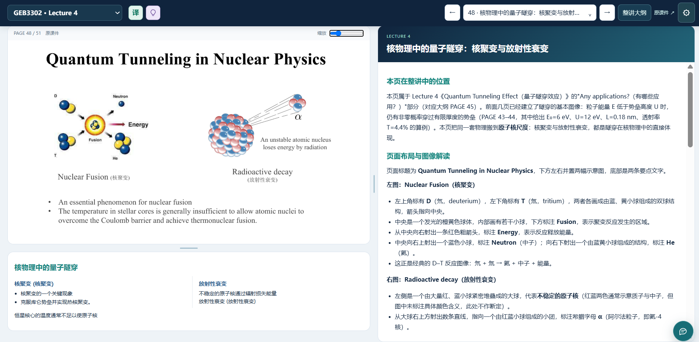
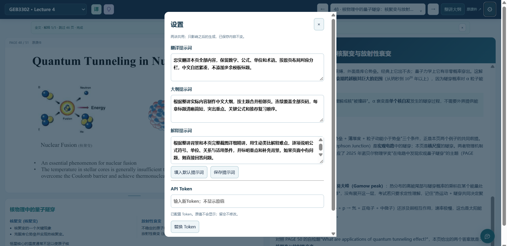

# LectureReview

**把 PDF 课件、中文翻译、知识讲解和课件问答放进同一个阅读工作台。**

原课件在左上、翻译在左下、解释在右侧。拖动分隔线即可分配屏幕空间，也可以在同一局域网的 iPad 上阅读。



*使用界面示例。下载后的程序不附带图中的课件和笔记，请自行上传 PDF。*

## 你需要准备什么？

1. **Windows 电脑及 Python 3.10+**。没有 Python 时，请从 [Python 官网](https://www.python.org/downloads/windows/) 安装，勾选 **Add python.exe to PATH**。
2. **PDF 课件**。当前只接受 PDF，不接受 PPT/PPTX，请先从 PowerPoint 导出 PDF。
3. **首次安装依赖时能联网**。依赖装好后，本地导入和阅读无需联网。
4. **可选：DeepSeek API Token**。只有生成翻译、解释、大纲和发送问题时需要；单纯上传、阅读不需要。

不需要学校账号、不需要 GitHub Token，也不需要提供任何密码。

## 三步开始

### 1. 下载并一键启动

从本仓库 **Code → Download ZIP** 下载并解压到一个可以写入的文件夹，例如 `E:\Apps\LectureReview`。请先解压，不要在 ZIP 内直接运行。

**双击根目录的 `start.bat`。**

它会检查 Python、创建项目专用 `.venv`、安装缺失依赖、启动服务，并自动打开浏览器。之后再次双击通常无需重复安装。

- 默认入口：<http://127.0.0.1:8767/>。
- 端口被占用时自动选择附近空闲端口，实际网址显示在启动窗口。
- 已运行同一份项目时复用已有入口，不会关闭其他程序。
- 不自动安装 Python、不申请管理员权限、不修改防火墙。

### 2. 上传课件

点击左上角 **＋**，选择 PDF，填写课程与课件名称，点击 **上传并导入**。

导入完成后，点击 **打开课件**。之后可通过左上角列表切换。导入生成页面截图、全文文字和布局信息，**不调用模型，不产生 API 费用**。

### 3. 按需启用 AI

在电脑本机页面打开右上角 **⚙ 设置**，填写 DeepSeek Token 并保存，然后刷新页面。

- 点击 **译**：生成当前页翻译。
- 点击 **灯泡**：生成当前页解释。
- 点击 **整讲大纲**：手动生成课程结构。
- 点击右下角 **问答图标**：针对课件提问。

已保存内容浏览时直接读取。点击已有翻译或解释，会先确认是否重新生成。

## 功能与操作

### 阅读与布局

- 左上原课件、左下翻译、右侧解释，边距随屏幕调整。
- 左右分隔条调整栏目宽度，左栏横向分隔条调整 PPT/翻译高度。
- 问答窗口可拖动位置、调整大小。
- 当前浏览器记住布局；设置内可恢复默认布局。
- Markdown、表格、代码及 LaTeX 公式使用本地资源渲染，无需 CDN。

### 翻译、解释和大纲

- 翻译按提取的页面布局分栏显示。
- 解释使用 **整讲文字＋当前页截图**，不仅是提取的文字。
- 页码目录支持搜索、单页生成、按大纲章节生成及全文生成。
- 批量任务只补缺失内容，每页完成即保存。可停止剩余队列。
- 三类提示词可在设置中调整，所有课件共用，只影响之后的生成。

### 连续问答

问答使用整讲文字、当前页截图、当前页已有翻译/解释及最近对话。历史按课件和页码独立保存，电脑与 iPad 访问同一服务时可看到同一份记录。

完整历史保留，发送时最多带最近6轮、合计18000字符，避免对话越长输入量无限增长。

### 自定义提示词

打开右上角 **⚙ 设置**，分别编辑 **翻译、大纲、解释** 的提示词，再点击 **保存提示词**。例如：

- 翻译：要求保留中英术语、数字、单位和公式，并按原课件左右布局分栏。
- 大纲：指定按主题合并相邻页，突出重点公式、页码范围和复习顺序。
- 解释：要求先讲直观含义，再逐个解释公式符号、单位、适用条件和常见误区。

提示词由所有课件共用，保存后一直保留；**不会自动重写已经生成的内容，也不会因为保存而调用 API**。若要将新提示词用于已有页面，点击对应生成按钮并确认重新生成。程序所需的输出格式约束仍由系统维护。

点击 **填入默认提示词** 可恢复默认文本，再点击 **保存提示词** 才会保存。API Token 在同一设置窗口单独配置，留空不会修改原值；请勿把 Token 写进提示词。



## 费用与资料限制

**不会调用模型：** 上传、导入、浏览已保存内容、调整布局、保存设置。

**会调用模型：** 生成/重新生成翻译、解释、大纲，以及发送问题。使用你自己的 Token，费用由供应商收取，模型固定 `deepseek-flash`，关闭 thinking。本地费用估算不代替实际账单。

- 每份 PDF 最大 **60MB、300页**。
- 不支持加密 PDF，不执行 PDF 内的指令。
- 扫描版无 OCR：可查看截图，但文字提取和文字翻译可能受限。
- AI 可能遗漏或误解内容，请对照老师课件，不把输出当作权威答案。
- 同名文件重新上传会创建独立课件，不覆盖旧资料。

## 在 iPad 上使用

1. 电脑与 iPad 连接同一可信局域网。
2. 保持电脑及服务运行。
3. 将启动窗口显示的局域网网址输入 iPad 浏览器。
4. 若访问被阻止，自行检查 Windows 防火墙；程序不会自动开放端口。

上传课件在 **8780–8899** 范围分配独立阅读端口，切换后网址可能改变。如果首页能打开而某份课件打不开，请检查对应端口是否允许访问。

## 保存在哪里？怎样备份？

资料均保存在项目文件夹内：

- `uploaded-decks/`：原始 PDF、页面截图、全文文字、生成笔记及问答历史。
- `data/`：提示词设置等运行状态。
- `.secrets/deepseek.txt`：默认 Token 文件。
- `.venv/`：项目 Python 环境，可重新安装。

备份 `uploaded-decks/` 和 `data/` 即可保留学习资料；Token 请单独安全保管。换电脑时先安装 Python，再复制资料并运行启动脚本。

**不要直接删除数据目录来“更新程序”。** 更新前先备份，不要用新 ZIP 整体覆盖并清空旧文件夹。

## 安全提醒

本项目面向本机或可信局域网，**没有登录认证或 HTTPS，请勿暴露到公网**。局域网内能访问服务的人可能查看资料或使用生成接口。

Token 只允许在电脑 localhost 页面替换，不返回原值、不放入模型上下文、不写入仓库。它仍是本机明文文件，请保护访问权限。PDF 上传与问答通过普通 HTTP 传输，不提供传输加密。

仓库不附带原始课件、学生名单、完整生成笔记、问答记录或任何密钥，仅包含经过检查的界面示例截图。上述运行数据已经加入 `.gitignore`；只有 `docs/images/` 内精选的 PNG 截图允许提交。

## 常见问题

**双击后提示找不到 Python**

安装 Python 3.10+，勾选 PATH 选项。Windows 的“Python 应用执行别名”不等于已安装 Python。

**第一次启动较慢／依赖安装失败**

首次需要下载 PyMuPDF。检查网络、pip 代理设置和项目文件夹权限，再运行脚本重试。后续只在依赖缺失或配置变化时安装。

**AI 按钮不能使用**

先在电脑本机设置 Token，再刷新。Token 保存不等于验证成功；若生成时失败，请检查额度、Token 有效性与网络。

**重启后课件不见了**

确认启动的是同一项目文件夹。每个副本有自己的数据；不要只复制代码而遗漏 `uploaded-decks/`。

**怎么停止？**

启动窗口按 **Ctrl+C** 停止本次入口。上传课件的后台阅读服务可能仍在运行；再次启动会复用/恢复已有课件服务。关闭电脑后，需要重新运行启动脚本。

## 进阶启动

Windows：

```powershell
# 只检查 Python 和依赖
.\start.bat -CheckOnly

# 指定首选端口，不自动打开浏览器
.\start.bat -Port 9000 -NoBrowser
```

已有 Python 环境时，也可手动启动。macOS/Linux 使用下面的方式：

```bash
python3 -m venv .venv
.venv/bin/python -m pip install -r requirements.txt
.venv/bin/python launcher.py
```

自定义 Token 文件位置（不自动读取 `.env`）：

```powershell
$env:DEEPSEEK_KEY_FILE = 'E:\your-private-keys\deepseek.txt'
.\start.bat
```

启动脚本的执行策略只作用于当前 PowerShell 进程，不改变系统长期执行策略。

## 开发与测试

```powershell
.venv\Scripts\python -m unittest test_cache test_uploads test_launcher
```

测试使用临时数据和模拟模型，不读取真实密钥、不调用付费模型。`ci-tests.example.yml` 提供 GitHub Actions 模板，启用时需要有相应权限的账号将它放到 `.github/workflows/tests.yml`。

代码入口：`server.py` 为 HTTP/AI 服务，`uploads.py` 为 PDF 导入和课件管理，`launcher.py` 为启动管理，`dist/` 为阅读界面。

## 第三方组件

KaTeX、Marked、DOMPurify 随代码提供，许可证见 `THIRD_PARTY_NOTICES.md`。PyMuPDF 安装在本机环境中，其 AGPL/商业许可条件与项目代码分开，请查阅上游条款。
